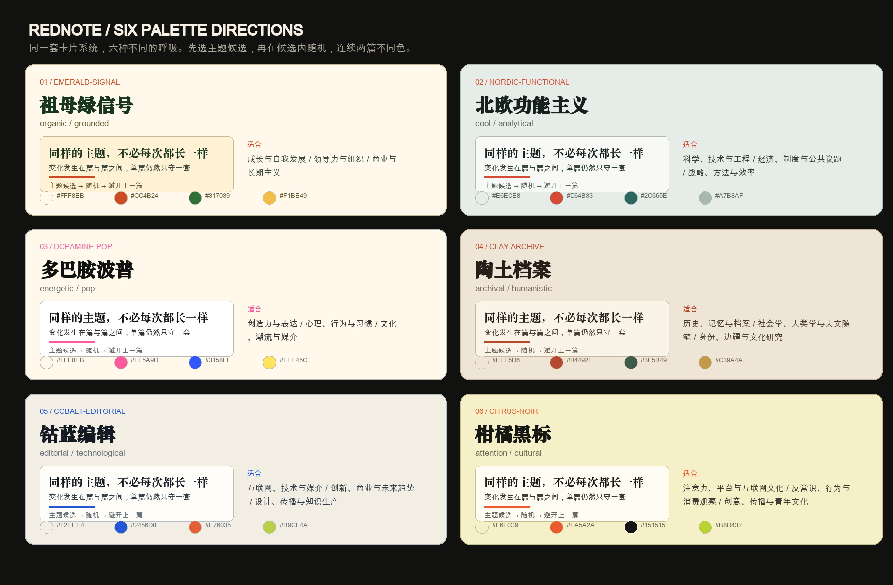

# 书主题色板

每篇新 post 只选一套色板。先判断**这本书在讲什么、读者带着什么问题进来**，再看书封颜色；
不能只按“最近喜欢哪种风格”选。视觉样片见 [`palette-directions.jpg`](palette-directions.jpg)。



## 选择顺序

1. 用一句话写主题：这本书主要处理**知识解释、能力成长、还是情绪与表达**？
2. 按下面的表列出 **2–3 套主题上都能接受的候选**。不要把所有色板都丢进随机池。
3. 用 `apply_palette.py auto` 在候选里随机；脚本会读取同工作区最近一篇的排期，自动排除同色。
4. 一套色板贯穿封面和全部内容卡，不混搭。把判断写进 `manifest.json.palette.reason`。

```bash
python3 <skill>/scripts/apply_palette.py --list
python3 <skill>/scripts/apply_palette.py <post-dir> auto \
  --candidates clay-archive,cobalt-editorial,dopamine-pop \
  --reason "互联网注意力与自我训练主题：陶土、钴蓝和柑橘都能承载分析，但不会做成危机海报"
```

脚本会复制 `build/palette.css`、按顺序接到 `card.css` 后面，并写入：

```json
"palette": {
  "id": "cobalt-editorial",
  "name": "钴蓝编辑",
  "family": "editorial / technological",
  "reason": "互联网注意力与自我训练主题：陶土、钴蓝和柑橘都能承载分析，但不会做成危机海报",
  "selection": {
    "mode": "random",
    "candidates": ["clay-archive", "cobalt-editorial", "dopamine-pop"],
    "excluded": ["nordic-functional"],
    "anti_repeat": true,
    "previous": {
      "id": "nordic-functional",
      "post": "你们吵的不是事实，是站位",
      "scheduled_for": "2026-11-16 08:00 Asia/Shanghai"
    }
  }
}
```

`auto` 的候选至少两套。若候选里只剩上一篇用过的那一套，脚本会直接失败，不会悄悄重复。
手选 `<palette-id>` 也会检查上一篇；同色时拒绝执行。

## 六套色板

| id | 名称 | 主题信号 | 适合 | 避开 |
| --- | --- | --- | --- | --- |
| `emerald-signal` | 祖母绿信号 | 生长、落地、长期 | 成长、领导力、组织、商业、自然、韧性 | 需要冷静技术图纸感的内容 |
| `nordic-functional` | 北欧功能主义 | 冷静、分析、秩序 | 科学、技术、经济、制度、战略、哲学、认知 | 强情绪、派对感、轻内容 |
| `dopamine-pop` | 多巴胺波普 | 能量、反差、传播 | 创造力、行为心理、文化、潮流、青年、反常识 | 战争、灾难、死亡、创伤、危机复盘 |
| `clay-archive` | 陶土档案 | 纸张、记忆、历史 | 历史、档案、社会学、人类学、边疆与身份研究 | 需要高能传播和派对感的主题 |
| `cobalt-editorial` | 钴蓝编辑 | 现代、理性、编辑感 | 互联网、技术、创新、媒介、设计与知识生产 | 古典档案气质、暖色回忆录 |
| `citrus-noir` | 柑橘黑标 | 锐利、反常识、注意力 | 平台文化、行为观察、传播、青年文化、短句观点 | 战争、灾难、死亡、创伤、长制度分析 |

### 轮换规则

- **不再有固定默认色。** `default` 只作为脚本兜底标记，不用于跳过主题判断。
- 随机只发生在**主题候选集**里；不要为了变化把灾难、创伤主题交给多巴胺。
- **连续两篇不能同色。** 排序看 `publish.scheduled_for`，没有排期时看发布时间／`read_at`。
- 严肃公共议题优先 `nordic-functional`、`clay-archive` 或 `cobalt-editorial`，不是默认套绿色。
- `dopamine-pop` 与 `citrus-noir` 适合短句和反差；五张都承载长解释时，优先选更稳的一套。
- 书封本身颜色很强时，先保证书封是识别主体，再用色板收住页面；不要为了配色把书封叠滤镜。
- 单篇内不要一会儿北欧、一会儿多巴胺；变化发生在**篇与篇之间**。

## 色值

### 祖母绿信号

`#317039` 绿 / `#F1BE49` 黄 / `#CC4B24` 陶红 / `#F8EDD9` 奶油 /
`#FFF1D4` 木瓜 / `#FFF8EB` 拿铁。

### 北欧功能主义

`#E6ECE8` 冷灰绿 / `#17211D` 墨黑 / `#D64B33` 信号红 / `#2C665E` 峡湾绿 /
`#F8F9F6` 白面。

### 多巴胺波普

`#FF5A9D` 热粉 / `#FFE45C` 柠檬黄 / `#3158FF` 钴蓝 / `#111111` 黑 /
`#FFF8EB` 奶油底。

### 陶土档案

`#EFE5D6` 纸灰 / `#B4492F` 陶土 / `#3F5B49` 深鼠尾草 / `#C39A4A` 赭金 /
`#FAF3E8` 米纸。

### 钴蓝编辑

`#F2EEE4` 暖象牙 / `#2456D8` 钴蓝 / `#E76035` 朱橙 / `#B9CF4A` 黄绿 /
`#FFFDF7` 白纸。

### 柑橘黑标

`#F6F0C9` 柠檬纸 / `#EA5A2A` 橘红 / `#151515` 黑 / `#B8D432` 青柠 /
`#FFFDF3` 奶白。

## 判断例子

- 《如何在自己感兴趣的领域出类拔萃》：成长与学徒期 → `emerald-signal`。
- 《科学革命的结构》：范式、证据与知识制度 → `nordic-functional` 或 `cobalt-editorial`。
- 《有所不为的反叛者》：史料、记忆与边疆 → `clay-archive` 或 `nordic-functional`，下一篇避开上一篇。
- 《浅薄》：互联网、注意力与媒介 → `cobalt-editorial`、`citrus-noir` 或 `dopamine-pop`。
- 金融危机亲历、战争、灾难、疾病回忆录 → `nordic-functional`、`clay-archive` 或 `emerald-signal`，不用多巴胺／柑橘黑标。

## 使用约束

- `--accent` 只做短句、关键词、序号和引用边线；整段正文走 `--ink2`。
- `--accent-wash` 必须和 `--accent` 同色系，不能一个色板里出现两套信号色。
- 卡片 HTML 里的局部硬编码颜色要改成 `var(--accent)` / `var(--accent2)` / `var(--accent3)`。
- 选完后把理由写进 manifest；`check_content.py` 会核对 `palette.id`、`reason`、实际 `--accent`，
  以及启用新选择器后连续两篇是否同色。
